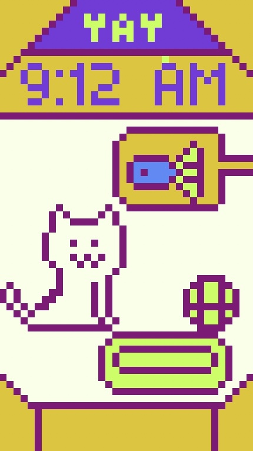

# Tomakitty

Tomakitty is a cute little desktop application where you have a virtual pet named Tomacat or whatever you wanna call it and you have to take care of it. Here is some concept art of Tomakitty:



## Roadmap

Tomakitty is a work in progress; however, here's a list of planned features just so you know what will be in the game.
- Hunger system
- Tiredness system
- Push notifications(You can turn these off)
- Settings
- Custom music
- More animations

### Already added features
- Time
- Boredom System
- Idle animation

## Installation

```bash
git clone https://github.com/apollo-cool/tomakitty.git
```

From there just open the project on Godot.
